# azentio.ai: Website & Intelligent Collaboration Portal

Enterprise AI website and secure collaboration portal for Azentio, built for the azentio.ai hackathon.
It has three audiences:
- public visitors, who discover offerings
- employees, who get an internal playground, live sessions and experiments
- client organisations, who get private workspaces

The core is a governed collective-learning loop: clients contribute market observations, moderators
de-identify and publish them, themes roll up into improvement ideas, and AIRA (an AI assistant) answers
questions with citations to approved evidence only.

> **Live:** https://gz67ge67.insforge.site · all 10 [build phases](docs/BUILD_PHASES.md) complete · [demo script](docs/DEMO.md) · [success metrics](docs/SUCCESS_METRICS.md)

## Highlights
- **Server-enforced access:** Postgres RLS + tenant membership + separate grants. Nothing is trusted from the browser.
- **Contribution lifecycle:** draft → submitted → returned ⇄ submitted → published / rejected → withdrawn. Every transition is audited.
- **Privacy by design:** published copies hold only reviewed fields, 4 separate consents (store / publish / attribute / train), trend counts suppressed below 3 organisations, withdrawal purged in ≤ 60 s.
- **AIRA:** read-only assistant over published shared learning (Postgres full-text retrieval through the caller's RLS, InsForge Model Gateway). 15 layered guardrails: deterministic input checks, citations must come from retrieved sources, and a red-line output guard. The answer is complete before anything is shown. Evaluated with the H.I.R.E. framework on a 60-question gold set.
- **AI assists (suggestions only):** redaction suggestions, duplicate detection (`pg_trgm`), theme clustering and naming, and cited trend digests.
- **Federated learning (P2):** opt-in demo with 3 isolated synthetic client datasets, FedAvg, update clipping/validation, dropout, and a candidate model registry with human approval.

## Screenshots
Captured with Playwright from the live site, signed in through the demo accounts (`npm run screenshots` regenerates them).

| | |
|---|---|
| 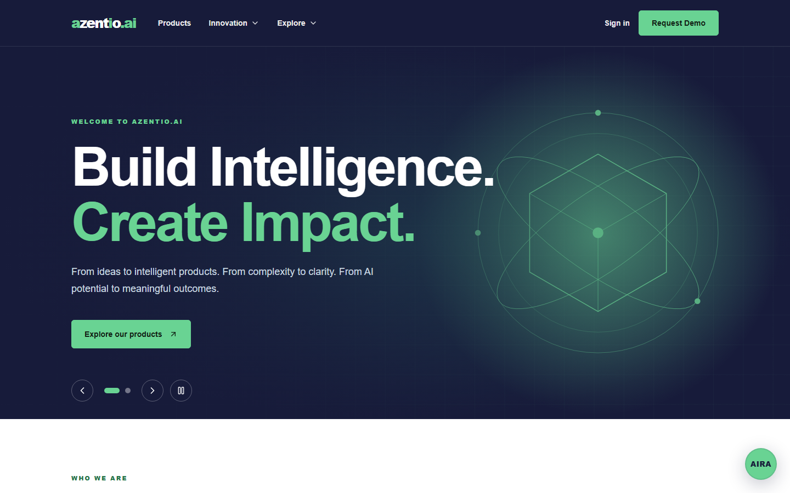 **Public home** | 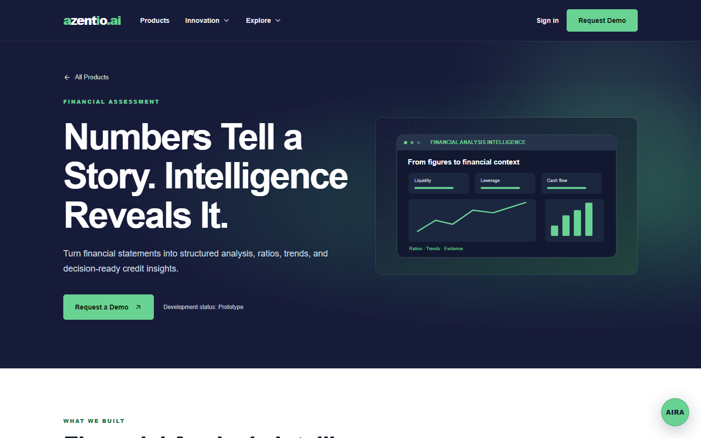 **Product page** |
| 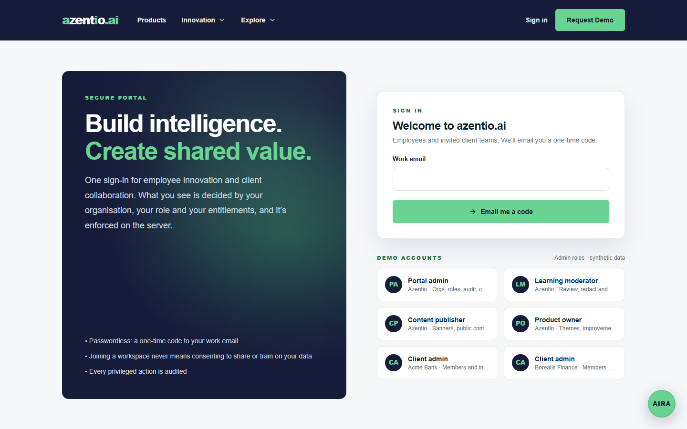 **Sign in: email OTP + demo accounts** | 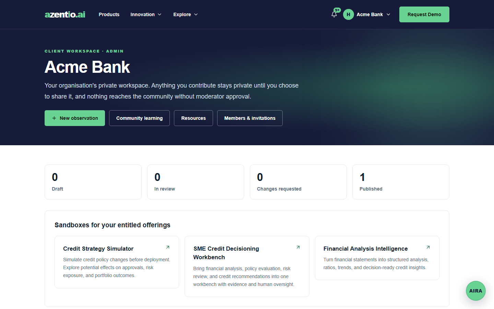 **Client workspace (Acme Bank)** |
| 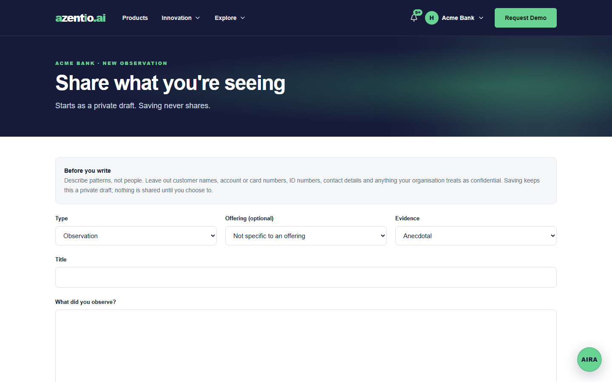 **Structured contribution with consents** | 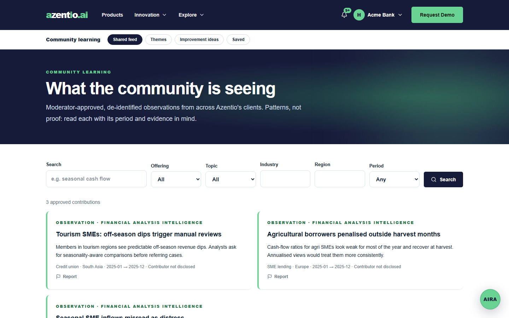 **Shared learning feed** |
| 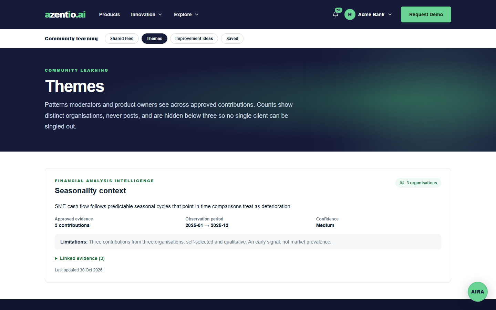 **Themes (k ≥ 3 organisations)** | 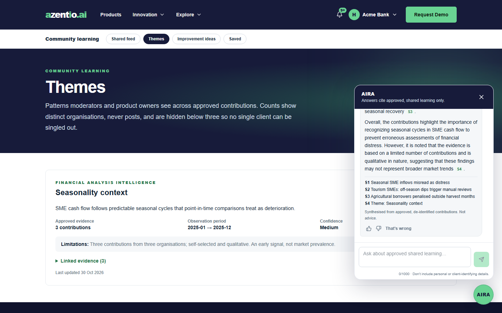 **AIRA answer with cited sources** |
| 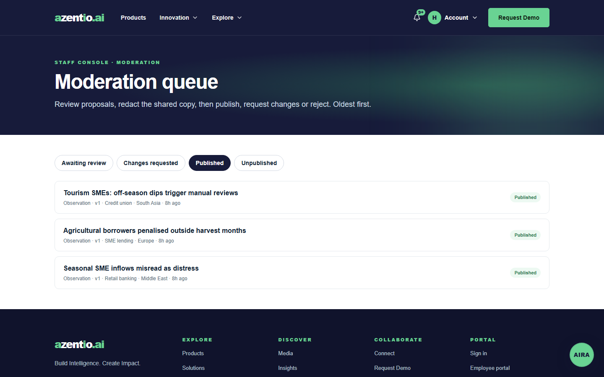 **Moderation queue** | 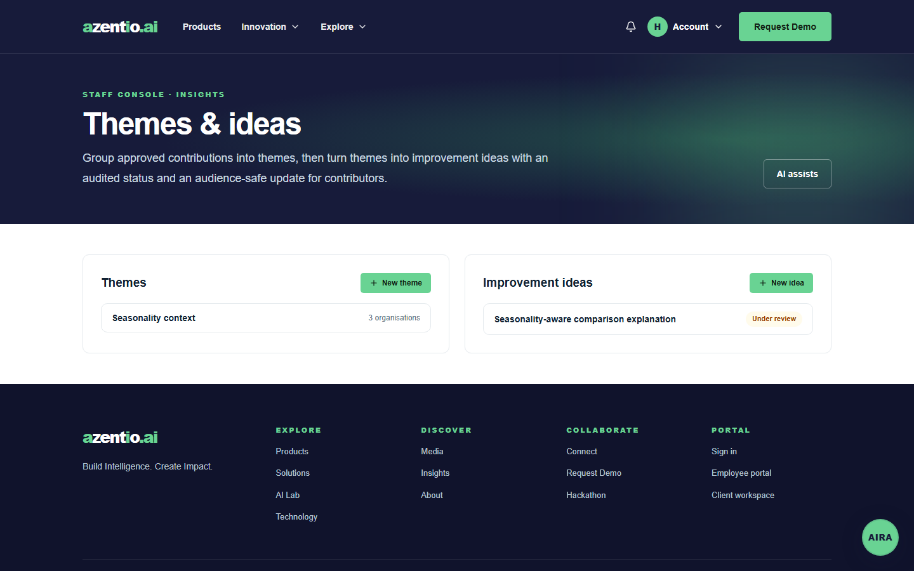 **Themes & improvement ideas** |
| 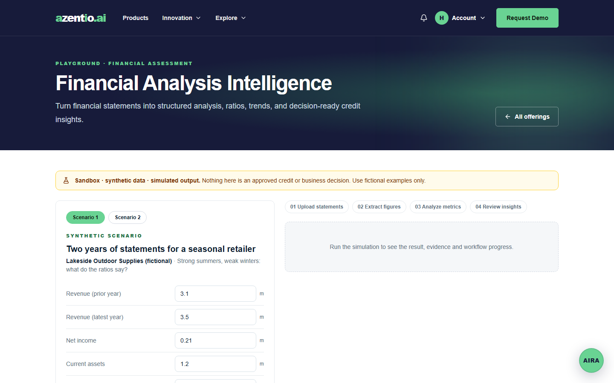 **Employee playground (simulated)** | 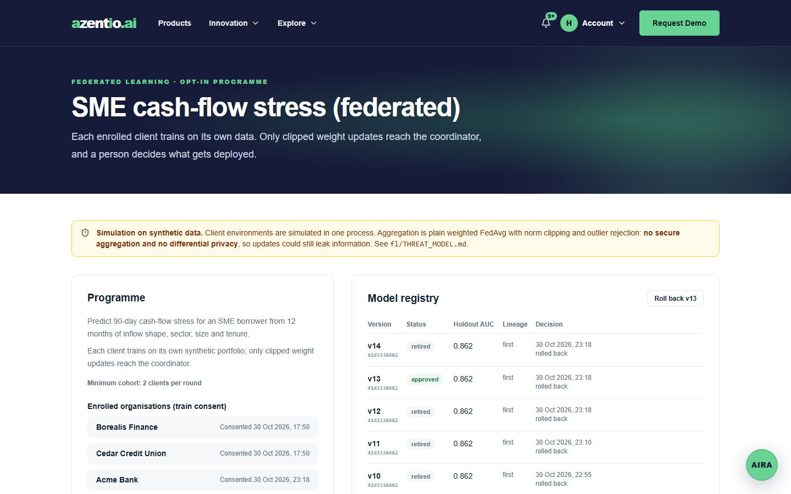 **Federated learning: registry & rounds** |
| 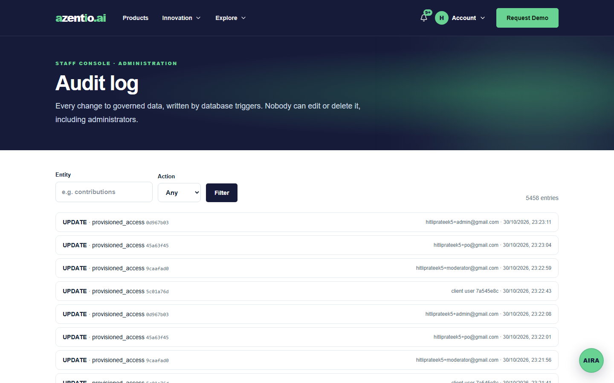 **Append-only audit log** | 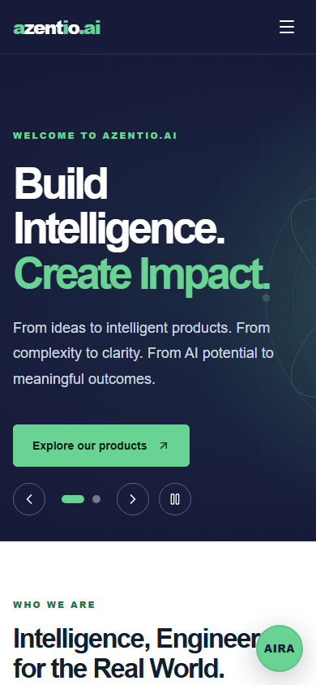 **Mobile** |

## Test status
Run against the live deployment on 31 Oct 2026. Details in [success metrics](docs/SUCCESS_METRICS.md).

| Suite | Result |
|---|---|
| Playwright e2e, all 13 specs (`PW_BASE_URL=https://gz67ge67.insforge.site`) | **69/69 passed** |
| RLS matrix through the real API (`npm run test:rls`) | **207/207 passed** (2 unverified personas skipped) |
| Unit, lint, typecheck | clean |
| Federated learning exit check (`python fl/test_fl.py`) | passes: federated AUC 0.862 vs local-only 0.824 |
| InsForge advisor | 0 critical, 0 warning |

## Tech stack
| Layer | Choice |
|---|---|
| Web | Next.js 16 (App Router, Cache Components, TypeScript), Tailwind CSS |
| Backend | InsForge: Postgres + RLS, Auth (email OTP), Storage (private buckets, signed URLs), Realtime |
| AI | InsForge Model Gateway (OpenRouter, `openai/gpt-4o-mini`), Postgres FTS + `pg_trgm` |
| Federated learning | Python (numpy FedAvg) in `fl/` |
| Tests | Playwright, SQL RLS tests, AIRA gold set |
| Hosting | InsForge deployments (Vercel-backed) + InsForge cloud |

## Repository layout
```text
web/          Next.js app (public site, employee portal, client portal, staff consoles, API routes)
migrations/   InsForge SQL migrations (schema, RLS, lifecycle, audit, search)
fl/           Federated-learning demo (P2)
evals/        AIRA taxonomy + gold set
docs/         PRD, HLD, LLD, user flows, requirements, build phases, design system
```

## Documentation
| Doc | What's inside |
|---|---|
| [Requirements](docs/REQUIREMENTS.md) | The hackathon brief in Markdown |
| [PRD](docs/PRD.md) | Goals, personas, requirement IDs with priority, NFRs, metrics |
| [HLD](docs/HLD.md) | Architecture, trust boundaries, data flows, AI (H.I.R.E.) evaluation |
| [LLD](docs/LLD.md) | Schema, state machine, RLS, API surface, AIRA / purge / FL design |
| [User flows](docs/USER_FLOWS.md) | Mermaid flows per persona |
| [Build phases](docs/BUILD_PHASES.md) | Phase-by-phase plan with exit criteria |
| [AIRA guardrails](docs/AIRA_GUARDRAILS.md) | Layered chatbot guardrails (G1–G15), pipeline, data contract |
| [Design system](docs/design/DESIGN_SYSTEM.md) | Tokens, components, voice (from the reference prototype) |
| [Routes](docs/design/ROUTES.md) | Prototype sitemap → our route map |

## Getting started
Requirements: Node 20+, npm, Python 3.11+ (for `fl/`), an InsForge project. AI runs on the project's free Model Gateway credit (`npx -y @insforge/cli ai setup`).

```bash
cd web
npm install
cp .env.example .env.local   # fill in the values below
npm run dev                  # http://localhost:3100
```

| Variable | Where it's used |
|---|---|
| `NEXT_PUBLIC_INSFORGE_URL`, `NEXT_PUBLIC_INSFORGE_ANON_KEY` | Browser + server SDK (user-scoped) |
| `INSFORGE_API_KEY` | Server-only admin client (audited functions only) |
| `OPENROUTER_API_KEY`, `AIRA_MODEL` | AIRA and the AI assists (server-only) |
| `OUTBOX_RUN_SECRET`, `EMAIL_DELIVERY` | Email outbox worker; delivery is off unless `EMAIL_DELIVERY=insforge` (paid plan) |
| `K_MIN_ORGS` | Minimum distinct organisations for trend counts (default 3) |
| `NEXT_PUBLIC_APP_URL` | Invite links and auth redirects |

Database: `npx -y @insforge/cli db migrations up --all`, then `npm run seed` (synthetic orgs, users and observations).

> Never commit `.insforge/`, `.mcp.json` or `.env*`. They hold admin keys and are git-ignored.

## Demo personas (synthetic)
The seed creates the Azentio org plus 3 fictional client organisations: Acme Bank, Borealis Finance and Cedar Credit Union.
- Each persona is a plus-address on one demo inbox (`DEMO_INBOX`), for example `hitliprateek5+moderator@gmail.com`.
- Access is provisioned by email and binds on the first verified sign-in.

| Persona | Org | Grants |
|---|---|---|
| `employee` | Azentio | none |
| `moderator` | Azentio | moderate |
| `po` | Azentio | product_owner |
| `publisher` | Azentio | publish_media |
| `admin` | Azentio | portal_admin, manage_roles, invite |
| `acme-admin`, `borealis-admin`, `cedar-admin` | their client org | client admin |
| `acme-member`, `borealis-member`, `cedar-member` | their client org | client member |
| `multi` | Acme + Borealis | client member in both |

The admin-role personas also get demo passwords (`npm run demo:create`, then `npm run demo:verify <alias> <code>`), which are stored only in `web/.env.local`. They power the one-click demo-login buttons and the RLS tests.

## Scripts
| Command | Purpose |
|---|---|
| `npm run dev` / `build` / `start` | Next.js |
| `npm run seed` | Load synthetic data (idempotent) |
| `npm run test:rls` | RLS matrix as anon + each persona through the real API |
| `npm run demo:create` / `demo:verify` | Create and verify demo-login accounts |
| `npm run test:unit` | Engines, PII scan, AIRA guards, clustering (no network) |
| `npm run test:e2e` / `test:e2e:prod` | Playwright against dev / a production build; `PW_BASE_URL=https://…` targets a deployed site |
| `npm run test:aira` | AIRA gold set: red lines, citation validity, IRR, withdrawal |
| `npm run aira:metrics` | H.I.R.E. metrics CSV from live interactions |
| `npm run test:outbox` | Outbox idempotency, claim and retry |
| `npm run fl` | Federated-learning run → candidate model in the registry |
| `npm run screenshots [baseUrl]` | Regenerate `docs/screenshots/` with Playwright (defaults to the live site) |

## Deploying
```bash
# from the repo root (the linked InsForge project)
npx -y @insforge/cli deployments env set NEXT_PUBLIC_APP_URL https://<subdomain>.insforge.site   # plus the vars above
npx -y @insforge/cli deployments deploy web
```

## License
Hackathon project. All product information is indicative, and all data is synthetic.
