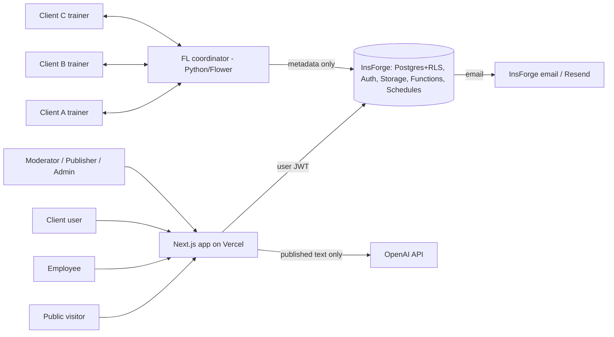

# azentio.ai portal: HLD (High-Level Design)

## 2.1 System context

## 2.2 Components
| Component | Responsibility | Tech |
|---|---|---|
| Web app | SSR pages, server actions, route handlers, UI | Next.js 15 App Router, TS, Tailwind v4, shadcn/ui, Framer Motion |
| Authz layer | Resolve session → user, active membership, grants. Guard every route. | `lib/authz.ts` + middleware |
| Data | Tables, RLS, triggers (state machine, audit), FTS, pgvector | InsForge Postgres |
| Auth | Email OTP, `disableSignup`, sessions | InsForge Auth (SSR integration) |
| Media | Private buckets, signed URLs via an audience-checking route | InsForge Storage |
| Functions | withdraw-purge, outbox-worker, embed-published, cluster-themes, aira-metrics | InsForge Functions + Schedules |
| AIRA | Retrieval (filtered) → OpenAI → citation and red-line guard → stream | Route handler `/api/aira` |
| FL | Trainers, coordinator, eval, registry sync | Python, Flower, PyTorch/sklearn, Docker Compose |

## 2.3 Trust boundaries & authorisation model
- **Boundary 1, browser → Next server:** nothing from the client is trusted (role, org ID, audience).
- **Boundary 2, Next server → DB:** queries run with the **user's** JWT, so RLS is the last line of defence. Service-role use is limited to audited functions (purge, outbox, embed, FL sync).
- **Boundary 3, DB → OpenAI:** only `shared_contributions` and theme text cross it.

Access decision = `audience_allows(user) AND (membership valid for resource.org if tenant-scoped) AND grant_allows(action) AND entitlement(offering) if gated`

## 2.4 Key data flows
- **Contribution:** draft (private) → submit → rules scan + LLM flag → moderation queue. On publish, write a `shared_contributions` row with reviewed fields → embed → feed, themes, AIRA.
- **Withdrawal:** author action → state `withdrawn` → trigger deletes the shared row and its embeddings, then busts caches (`revalidateTag`). Synchronous, so 0 s in the demo.
- **AIRA:** question → embed → pgvector search over the visible shared set → OpenAI with numbered sources → validate citations ⊆ retrieved IDs + red-line regex → answer or refusal → log.
- **Themes:** nightly/on-demand job clusters shared embeddings → LLM names the clusters → PO confirms → dashboard shows distinct-org count if ≥ 3.
- **Notifications:** state change → `notifications` row (in-app, realtime) + `outbox` row → worker sends email → marked delivered on the provider callback.
- **FL:** admin starts a run → coordinator checks consenting participants → rounds → metrics → candidate in `model_registry` → human approve/reject.

## 2.5 Deployment
- Vercel (prod + preview per branch)
- One InsForge project (prod) + a branch DB for tests
- `fl/` runs locally via Docker Compose during the demo
- Env vars: `INSFORGE_URL`, `INSFORGE_ANON_KEY`, `INSFORGE_SERVICE_KEY` (functions only), `OPENAI_API_KEY`, `OPENAI_MODEL`, `OPENAI_EMBED_MODEL`, `K_MIN_ORGS=3`

## 2.6 Observability
- Audit log UI for admins
- Function logs
- AIRA metrics page (5 H.I.R.E. metrics, 7-day trend)
- Error tracking (Vercel)

## 2.7 H.I.R.E. evaluation of the AI features
| Feature | R-gate result | Build as | Oversight |
|---|---|---|---|
| AIRA | Informational → chatbot/RAG | Read-only RAG | Deterministic retrieval filter + inline guard |
| PII flagging | Predictable → automation | Regex rules + LLM 2nd pass (suggest only) | Moderator |
| Redaction suggestion | 2 of 5 reasoning traits → not an agent | Single LLM call → diff | Moderator edits and publishes |
| Clustering / duplicates / trends | Predictable pipeline | Embeddings + clustering job + LLM labels | PO confirms |
| Assisted prioritisation | Informational | LLM summary card | PO decides |
| Playground AI demo | Informational, synthetic | LLM call labelled "Simulated" | n/a |

**Decision: no autonomous agents. All AI is read-only and suggestion-only.**

AIRA score: H 15 + I 11 + E 25 = **51 → HIRE (borderline)**. This only holds if retrieval filtering stays deterministic.
- **KPIs:** RLR 0%, IRR > 60%, UCR < 15%, DIY < 15%, citation validity 100%
- **Red lines:** cites a withdrawn/unpublished item, names another tenant, reveals employee-only content to a client, promises dates, emits PII
- **Review:** 2027-02-01
