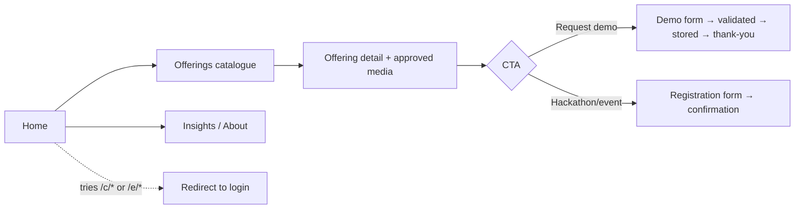
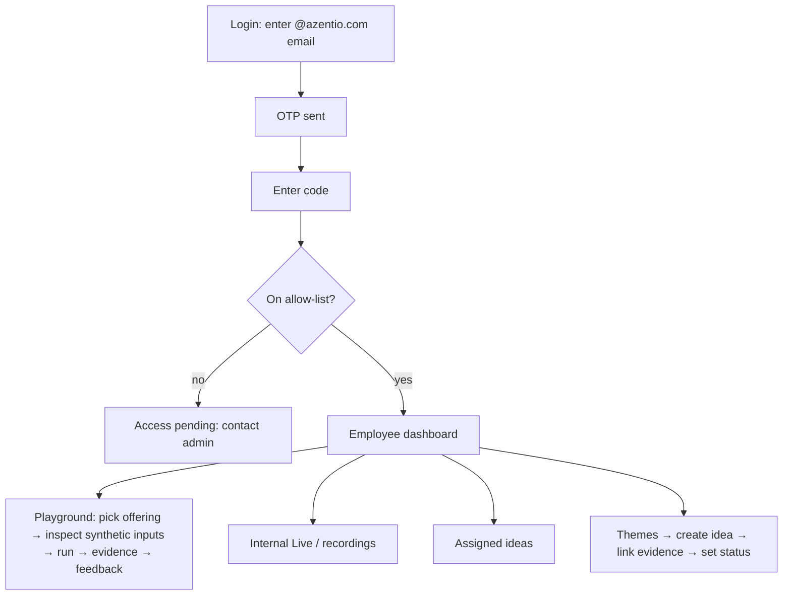
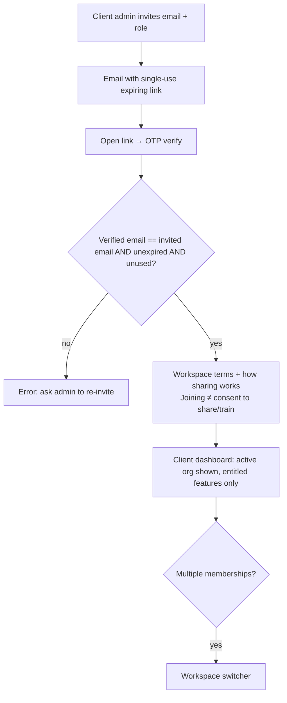
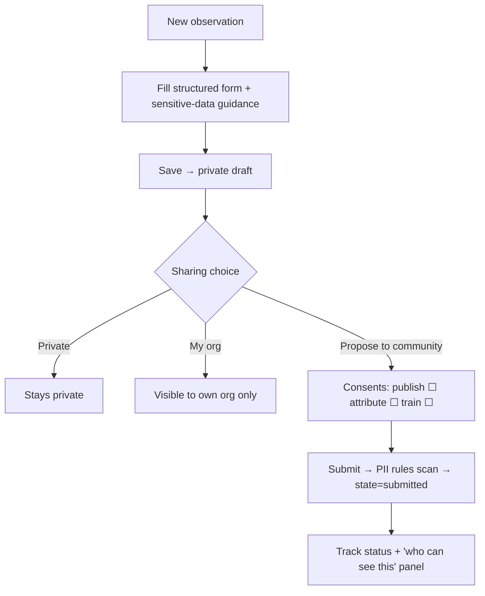
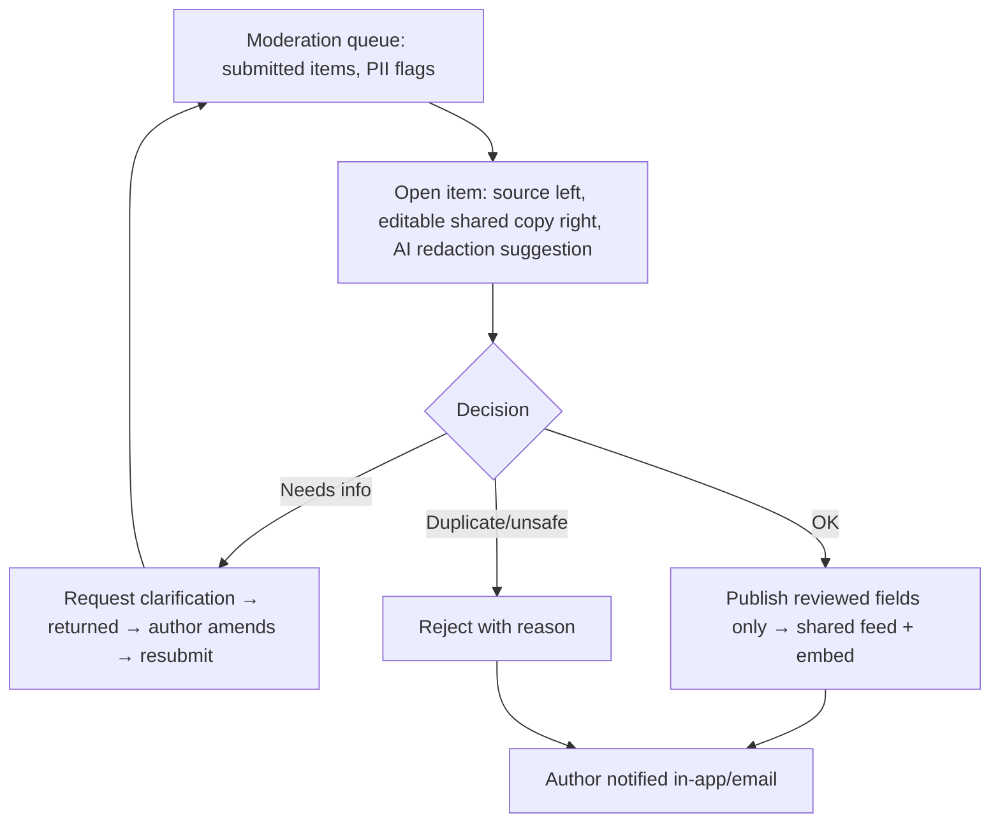
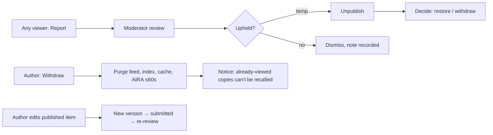
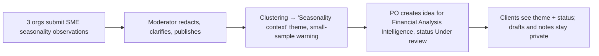

# azentio.ai portal: User flows

## 4.1 Public visitor

## 4.2 Employee sign-in & portal

## 4.3 Client first-time onboarding

## 4.4 Contribute an observation

## 4.5 Moderation

## 4.6 Report, withdraw, edit

## 4.7 Insight → improvement loop (brief's scenario)

## 4.8 Client admin
Members page → Invite (email, role ∈ {member, admin}) → pending list → revoke. Trying to grant moderator/employee returns an error (server + RLS).

## 4.9 AIRA
Ask → retrieve visible published items → answer with [S#] source cards, or "not enough evidence" → 👍 / 👎 / correct → logged for metrics.

## 4.10 Federated programme (P2)
Admin creates programme → client orgs opt in (train consent) → run → rounds view (participants, dropout, metrics vs baseline) → candidate model → human approve/reject → rollback option.
